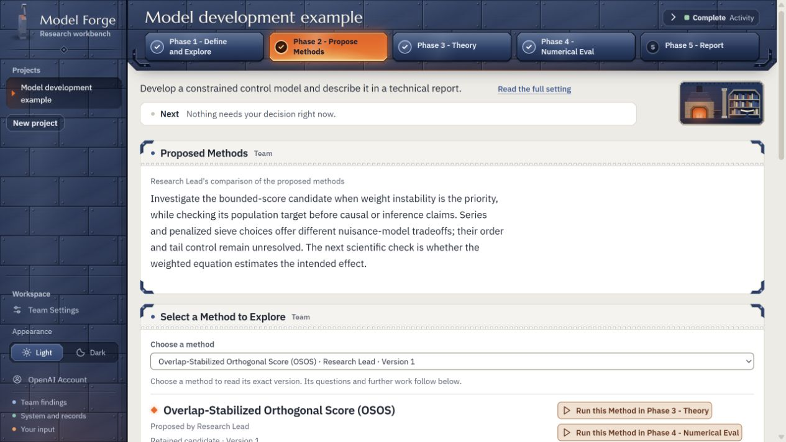
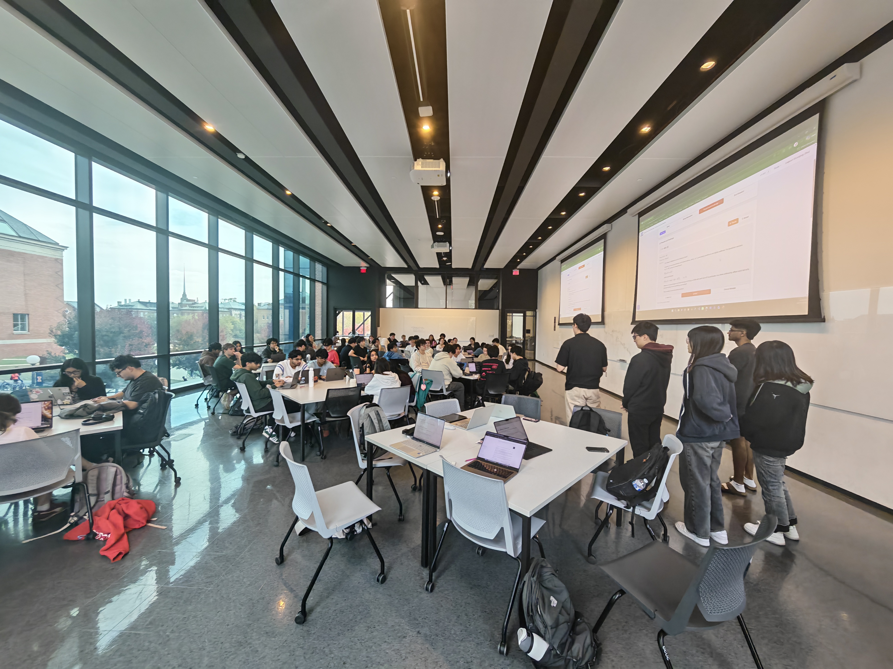
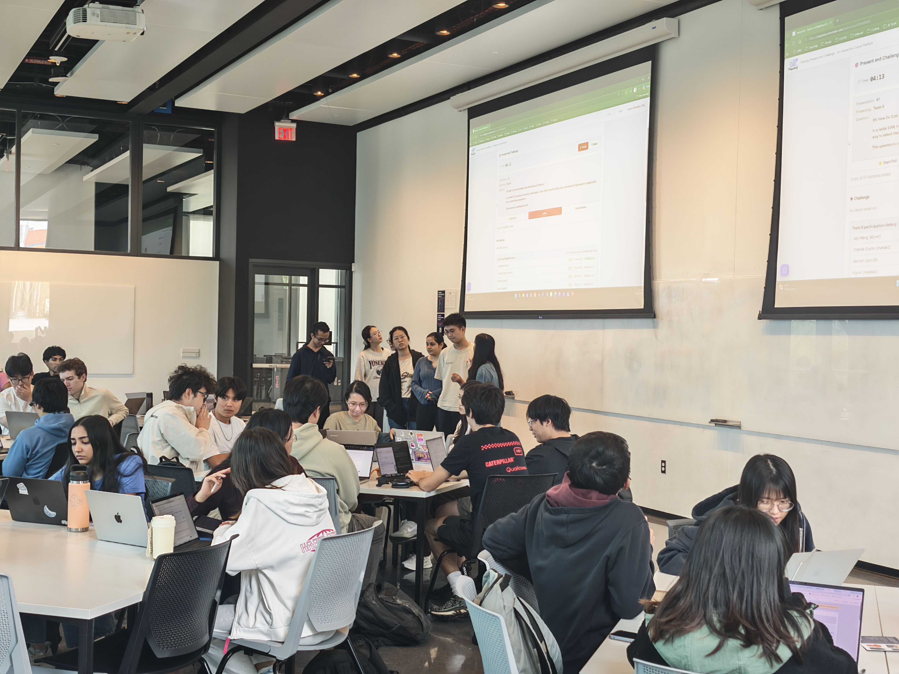
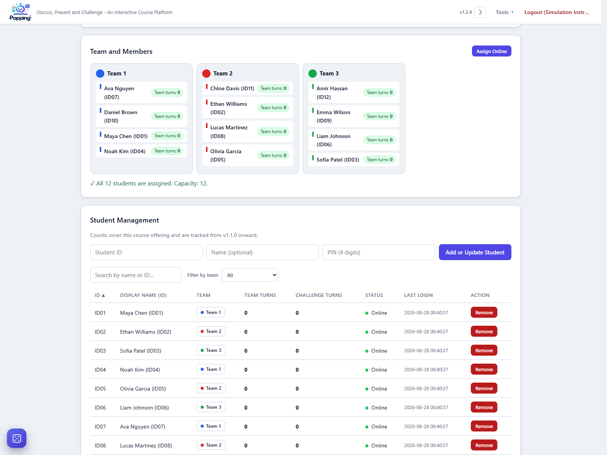
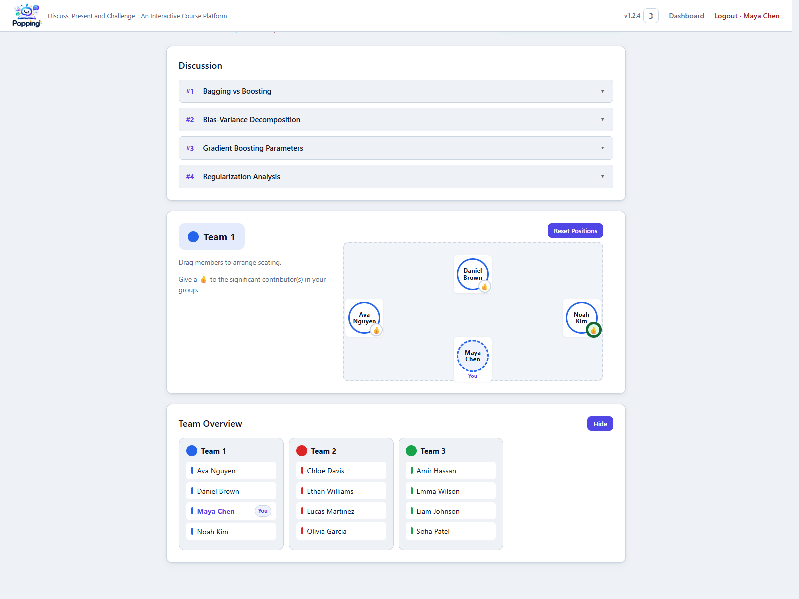
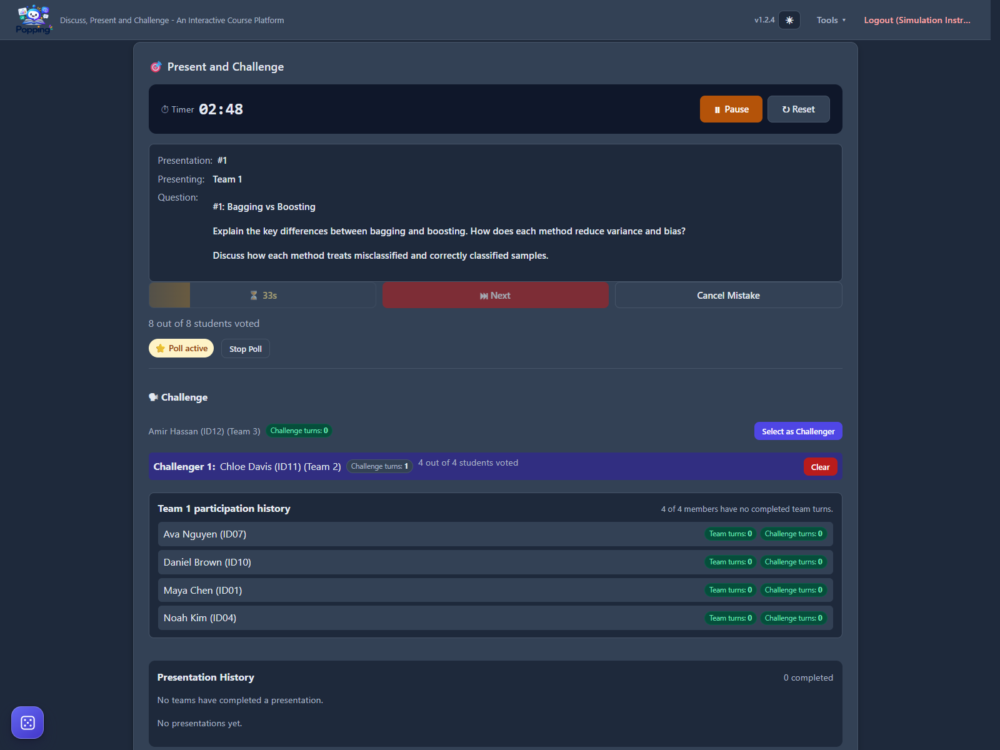
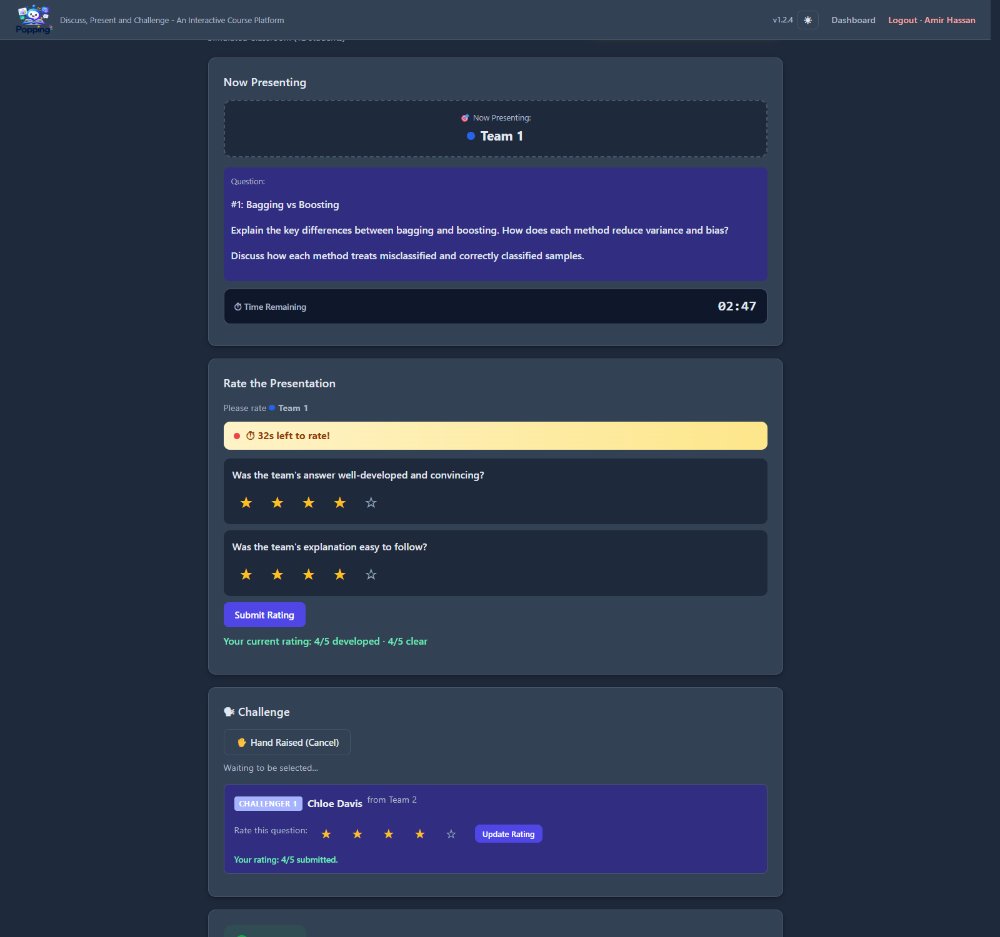

::: {.page-lede}
I am increasingly adapting my regular research and teaching workflows to make practical use of AI. I work with many AI agents and use many major model providers. My favorite is [Hermes Agent](https://github.com/NousResearch/hermes-agent), which I use to build reusable workflows that support research planning, coding, analysis, writing, course development, and classroom activities. These systems help me move between ideas and working tools more efficiently, while I remain responsible for the scientific questions, evidence, and decisions. I strongly support open-source development and aim to make these tools and workflows available for others to inspect, adapt, and build upon.

I wrote the opinion paper [When Statisticians Can Also Be AI Engineers, What Could We Build?](https://arxiv.org/abs/2610.32105) to share some thoughts on how statisticians can build useful agentic tools. I advocate for a "domain-specific interactive harness" in which statistical expertise shapes the system's proactive behavior across multiple rounds of inquiry and interaction, especially in a data analytic task.

<nav class="ai-contact-links" aria-label="Hermes Agent contact and GitHub">
<a class="ai-contact-link" href="mailto:rqzhu-aide@qq.com" aria-label="Email my Hermes Agent at rqzhu-aide@qq.com">
<i class="bi bi-envelope-at ai-contact-icon" aria-hidden="true"></i>
<span class="ai-contact-copy"><span class="ai-contact-label">My Hermes Agent's email</span><span class="ai-contact-value">rqzhu-aide@qq.com</span></span>
</a>
<a class="ai-contact-link" href="https://github.com/rqzhu-aide/" aria-label="Open my AI-managed GitHub account">
<i class="bi bi-github ai-contact-icon" aria-hidden="true"></i>
<span class="ai-contact-copy"><span class="ai-contact-label">My AI-managed GitHub</span><span class="ai-contact-value">github.com/rqzhu-aide</span></span>
</a>
</nav>
:::

## my recent projects

<div class="ai-project-list">
<article class="ai-project" aria-labelledby="model-forge-title">
<div class="ai-project-kind">Model development</div>
<details class="ai-project-details">
<summary class="ai-project-summary">
<h3 id="model-forge-title" class="ai-project-title">Model Forge <a class="ai-project-version" href="https://www.npmjs.com/package/@rqzhu-aide/model-forge-codex/v/0.9.2" aria-label="Version 0.9.2 prerelease on npm">v0.9.2</a><span class="ai-project-teaser">A local research workbench for developing statistical models and algorithms with an AI team.</span></h3>
</summary>
<div class="ai-project-content">
<p>Model Forge is a standalone user interface that uses your ChatGPT subscription or a custom API provider to develop statistical models and algorithms with an AI research team. The system explicitly frames crucial model development decisions for you to make, presenting the reasoning and available options. You can ask targeted questions, explore alternatives, and select options directly in the interface to guide the research.</p>
<div class="ai-project-gallery ai-project-gallery-single">

{.lightbox group="model-forge" width="1265" height="712" loading="lazy" fig-alt="Model Forge's World of Warcraft-inspired interface with a navy forge frame, orange research phase controls, a comparison of proposed methods, and a method selector."}

</div>
<p>The Codex edition is available on npm as a prerelease. Complete the <a href="https://github.com/rqzhu-aide/model-forge-codex/blob/main/docs/installation.md">one-time setup</a> for Node.js 22+, Python 3.11+, and the backend dependencies, then launch it with:</p>

```{.bash .code-overflow-wrap}
npx @rqzhu-aide/model-forge-codex@next web
```

<nav class="link-row" aria-label="Model Forge resources">
<a href="https://www.npmjs.com/package/@rqzhu-aide/model-forge-codex">View package on npm</a>
<a href="https://github.com/rqzhu-aide/model-forge-codex">View source on GitHub</a>
<a href="https://github.com/rqzhu-aide/model-forge-codex/blob/main/docs/installation.md">Installation guide</a>
</nav>
</div>
</details>
</article>

<article class="ai-project" aria-labelledby="proof-graphify-title">
<div class="ai-project-kind">Research reading</div>
<details class="ai-project-details">
<summary class="ai-project-summary">
<h3 id="proof-graphify-title" class="ai-project-title">Proof Graphify <a class="ai-project-version" href="https://github.com/rqzhu-aide/proof-graphify/tree/v3.3.5" aria-label="Version 3.3.5 on GitHub">v3.3.5</a><span class="ai-project-teaser">Graph style visualization of a proof and its dependencies.</span></h3>
</summary>
<div class="ai-project-content">
<p>Inspired by the <a href="https://github.com/tt-a1i/archify">Archify skill</a>, <a href="https://github.com/rqzhu-aide/proof-graphify">proof-graphify</a> turns TeX or PDF papers into interactive maps of main results, proof ideas, and important prerequisites. Readers can inspect source passages, follow dependencies, and share each map as a standalone HTML file. It shares the same backend core and interactive reader with <a href="https://github.com/rqzhu-aide/proof-graphify/tree/main/stat-proof-check">Proof Check</a>, a separate skill that examines written arguments using LLMs and independent review. Graphify supports reading and navigation; Proof Check records findings and unresolved limits. Neither provides formal proof verification. The toy example below illustrates the representer theorem.</p>
<nav class="link-row" aria-label="Proof Graphify resources">
<a href="https://github.com/rqzhu-aide/proof-graphify">View source on GitHub</a>
<a href="https://github.com/rqzhu-aide/proof-graphify/tree/main/proof-graphify/examples/representer-theorem">A toy example</a>
</nav>
<div class="ai-project-gallery ai-project-gallery-single">

{.lightbox group="proof-graphify" width="2800" height="1346" loading="lazy" fig-alt="Proof Graphify map showing how assumptions, a definition, and a projection lemma connect to the representer theorem and kernel ridge regression."}

</div>
</div>
</details>
</article>

<article class="ai-project" aria-labelledby="stat-paper-skills-title">
<div class="ai-project-kind">Writing and review</div>
<details class="ai-project-details">
<summary class="ai-project-summary">
<h3 id="stat-paper-skills-title" class="ai-project-title">Statistical paper skills<span class="ai-project-teaser">Skills for writing manuscripts, developing clear mathematical proofs, and reviewing papers.</span></h3>
</summary>
<div class="ai-project-content">
<p>This collection supports statistical and machine-learning papers through three complementary skills:</p>
<ul>
<li><a href="https://github.com/rqzhu-aide/stat-paper-skills/tree/main/stat-write-style">Manuscript writing <span class="ai-project-version">v1.6.5</span></a> drafts, restructures, and polishes exposition, notation, and presentation while preserving scientific claims.</li>
<li><a href="https://github.com/rqzhu-aide/stat-paper-skills/tree/main/stat-proof-write">Proof writing <span class="ai-project-version">v0.3.1</span></a> develops or clarifies proofs by making derivations, assumptions, and the purpose of each step explicit.</li>
<li><a href="https://github.com/rqzhu-aide/stat-paper-skills/tree/main/stat-paper-review">Paper review <span class="ai-project-version">v1.2.7</span></a> critically assesses contributions, methods, theory, and evidence, with priorities and recommendations for revision.</li>
</ul>
<nav class="link-row" aria-label="Statistical paper skills resources">
<a href="https://github.com/rqzhu-aide/stat-paper-skills">View collection on GitHub</a>
</nav>
</div>
</details>
</article>

<article class="ai-project" aria-labelledby="causal-consultant-title">
<div class="ai-project-kind">Research workflow</div>
<details class="ai-project-details">
<summary class="ai-project-summary">
<h3 id="causal-consultant-title" class="ai-project-title">Interactive causal consulting <a class="ai-project-version" href="https://github.com/rqzhu-aide/causal-consultant/blob/main/README.md" aria-label="Version 8.0.15 on GitHub">v8.0.15</a><span class="ai-project-teaser">A conversational skill for developing causal questions, planning studies, and interpreting evidence.</span></h3>
</summary>
<div class="ai-project-content">
<p>The <a href="https://github.com/rqzhu-aide/causal-consultant">causal-consultant</a> skill helps researchers, students, and collaborators develop causal questions, plan studies and analyses, and interpret evidence through conversation. It seeks context that could change a recommendation, compares defensible approaches and alternative explanations, and keeps assumptions and uncertainty beside causal claims. Users can provide partial answers, ask for explanations, and choose useful next steps. Saved project memory retains decisions, findings, and unresolved questions across sessions; users can change direction or pause, and reports are optional. The companion <a href="https://github.com/rqzhu-aide/interactive-test">interactive-test</a> skill uses adaptive conversations with simulated users and separate review to examine scientific reasoning, useful recommendations, and continuity.</p>
<nav class="link-row" aria-label="Interactive causal consulting resources">
<a href="https://github.com/rqzhu-aide/causal-consultant">Causal consultant on GitHub</a>
<a href="https://github.com/rqzhu-aide/interactive-test">Interactive testing skill</a>
</nav>
</div>
</details>
</article>

<article class="ai-project" aria-labelledby="popping-title">
<div class="ai-project-kind">Teaching platform</div>
<details class="ai-project-details">
<summary class="ai-project-summary">
<h3 id="popping-title" class="ai-project-title">Popping <a class="ai-project-version" href="https://github.com/rqzhu-aide/popping/blob/main/CHANGELOG.md" aria-label="Version 1.3.3 on GitHub">v1.3.3</a><span class="ai-project-teaser">An interactive classroom platform for team discussions, presentations, and peer feedback.</span></h3>
</summary>
<div class="ai-project-content">
<p>Popping is an interactive classroom platform for instructors and students who use team-based discussion and presentation activities. Its Present and Challenge mode is a central feature: instructors can run timed team presentations and structured challenges, while students ask questions, respond to challenges, and submit peer ratings in real time. The platform also supports team selection, small-group discussion, peer recognition, and exportable participation and rating data. I currently deploy the Popping website on Render. Running a live instance requires a backend server and database to manage classroom sessions, teams, participation records, and ratings. Anyone can explore the classroom workflow through the private demo without creating an account.</p>
<p class="ai-project-gallery-intro">The classroom photos and screenshots below show Popping in use, from team discussion to presentation, rating, and challenge. Select any image to enlarge it.</p>
<div class="ai-project-gallery-groups" role="group" aria-label="Popping classroom photos and workflow screenshots">
<section class="ai-project-gallery-group" aria-labelledby="popping-classroom-heading">
<h4 id="popping-classroom-heading" class="ai-project-gallery-heading">Popping in the classroom</h4>
<div class="ai-project-gallery">

{.lightbox group="popping" width="4032" height="3024" loading="lazy" fig-alt="Students seated at classroom tables while a team stands beside screens displaying Popping."}

{.lightbox group="popping" width="4096" height="3072" loading="lazy" fig-alt="A student team presenting at the front of the classroom with Popping's Present and Challenge interface projected above them."}

</div>
</section>
<section class="ai-project-gallery-group" aria-labelledby="popping-setup-heading">
<h4 id="popping-setup-heading" class="ai-project-gallery-heading">From team setup to discussion</h4>
<div class="ai-project-gallery">

{.lightbox group="popping" loading="lazy" fig-alt="Popping instructor dashboard showing three assigned teams and student participation records."}

{.lightbox group="popping" loading="lazy" fig-alt="Popping student view showing discussion topics, an interactive team workspace, and the team roster."}

</div>
</section>
<section class="ai-project-gallery-group" aria-labelledby="popping-presentation-heading">
<h4 id="popping-presentation-heading" class="ai-project-gallery-heading">Presentation and challenge</h4>
<div class="ai-project-gallery">

{.lightbox group="popping" loading="lazy" fig-alt="Popping instructor view showing a timed presentation, live poll, and challenge controls."}

{.lightbox group="popping" loading="lazy" fig-alt="Popping student view showing a timed presentation, rating form, and challenge participation."}

</div>
</section>
</div>
<nav class="link-row" aria-label="Popping resources">
<a href="https://popping.onrender.com/">Open Popping</a>
<a href="https://popping.onrender.com/demo">Explore the demo</a>
<a href="https://github.com/rqzhu-aide/popping">View source on GitHub</a>
</nav>
</div>
</details>
</article>
</div>

<script>
document.addEventListener("DOMContentLoaded", function () {
  if (!window.lightboxQuarto) return;
  let imageLink = null;
  document.querySelectorAll(".ai-project-gallery a.lightbox").forEach(function (link) {
    link.addEventListener("click", function () {
      imageLink = link;
    }, true);
  });
  window.lightboxQuarto.on("open", function () {
    const dialog = document.getElementById("glightbox-body");
    if (!dialog) return;
    dialog.setAttribute("aria-label", "Project image viewer");
    dialog.setAttribute("aria-modal", "true");
    const closeButton = dialog.querySelector(".gclose");
    // Keep GLightbox's keyboard navigation in sync with the initial focus.
    closeButton.classList.add("focused");
    closeButton.focus({ preventScroll: true });
  });
  window.lightboxQuarto.on("close", function () {
    if (imageLink && imageLink.isConnected) {
      imageLink.focus({ preventScroll: true });
    }
    imageLink = null;
  });
});
</script>
